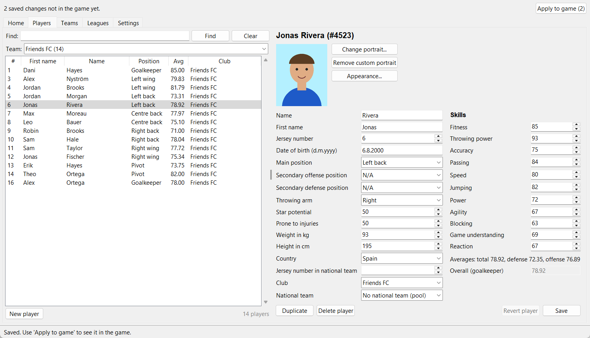
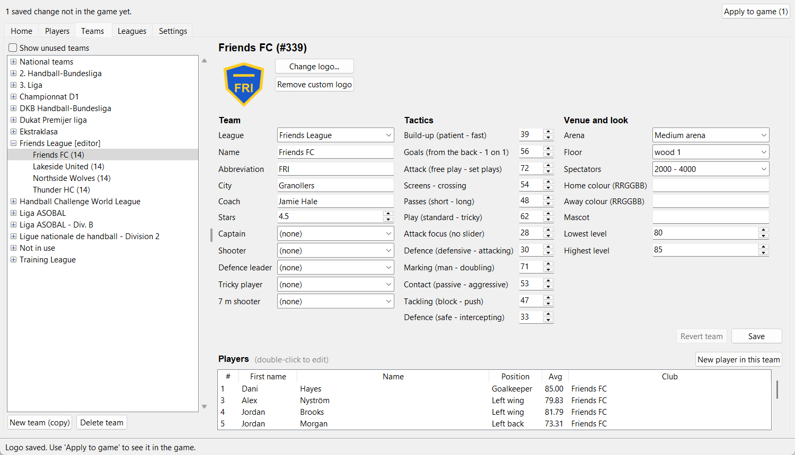
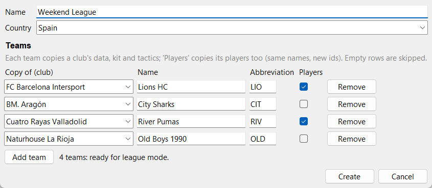
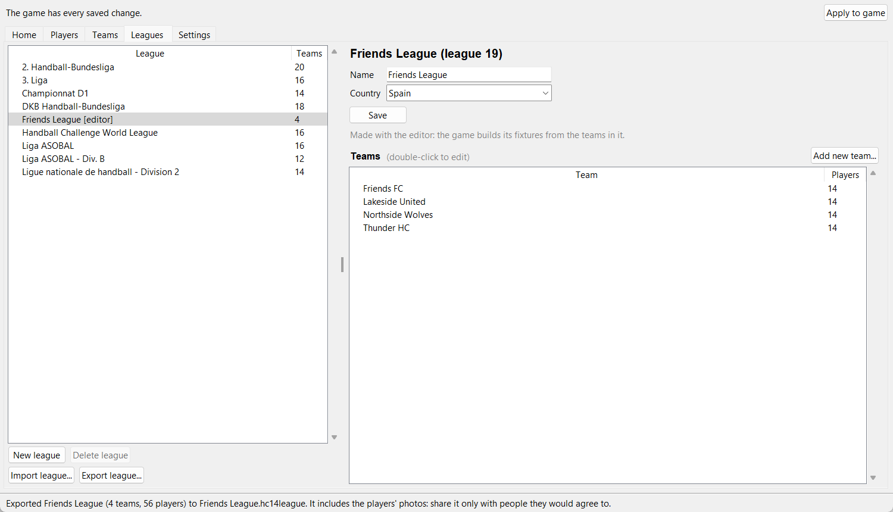

# IHFHCEditor

Windows editor for **IHF Handball Challenge 14**: edit the game's players, teams and leagues, create your own (your friends, with their photos and 3D look) and share leagues with other players of the game. Personal use, on your own copy of the game.

## Download and use
Download `IHFHCEditor-<version>-windows.zip` from the repository's Releases page.

1. Start the game at least once and then close it. On its first run the game creates its data files in your Documents folder (`neutron games\HandballChallenge14\save`), and the editor works on them: without them it has nothing to edit.
2. Unzip the editor somewhere you can write to (for example your Documents folder; not under Program Files). The editor keeps its working files next to `IHFHCEditor.exe`.
3. Run `IHFHCEditor.exe`. The first time, it finds the game in your Steam libraries (or asks where it is).
4. **Accept the two backups it offers on that first run**: "Original backup" (the game's data) and "Original portraits" (the players' photos). They are the copies that **Restore original** puts back, so they must be made while the game is still unedited. They are saved once, in the `backups` folder next to `IHFHCEditor.exe`, and never overwritten.
5. Edit, then use **Apply to game** with the game closed. **Game ▸ Restore original…** puts everything back.

The window and its tabs are described in [Usage](#usage). To update, unzip the new version into a new folder and copy the `backups` folder of the old one into it, so the editor keeps the original it saved first.

## Usage
Open `IHFHCEditor.exe` (or, from the source, `python -m app`: see [CONTRIBUTING.md](CONTRIBUTING.md)).

The window has five tabs, a **Game** menu, an **Apply to game (n)** button that counts the saved changes not in the game yet (the title shows `*` while there are some), and a status bar with what just happened. Saved changes go to a working copy; **Apply to game** installs them (the game must be closed). **Game ▸ Reload from game** discards changes not applied, and **Game ▸ Restore original…** installs the whole original data again. Ctrl+S saves the form of the tab shown; Ctrl+F jumps to the player search. On first start the editor offers to back up the installed data and the players' portraits as the originals; accept both (see [Download and use](#download-and-use)). Every change is recorded in `work/activity.log`. **Help ▸ About** shows the version.

- **Settings**: the game and save folders, with a check of each, **Browse…**, **Detect** and **Save**.
- **Home**: find a player, create a player (in the pools), a team or a league with their wizards, jump to a section, and the changes waiting with Apply, Reload and Restore.
- **New player** (Home, Players, or "New player in this team" in Teams) opens a wizard: data, the 11 skills, club and national team, a photo and the 3D look in one window. Nothing is written until **Create**; an untouched look keeps the game's default.
- **Players**: find players (any part of the first name and name, case and accents ignored: "raul entrerrios") or choose a team to list it; the chosen player's form is on the right. Data and skills are saved with **Save**; averages are recalculated (goalkeepers have a hand-set "Overall"). **Club** and **National team** move the player to another team (the pools 194 "Not assigned" and 319 "NOT ASSIGNABLE" mean no team); the editor warns about unusual rosters (fewer than 14 or more than 25 players), repeated jersey numbers and names longer than 20 characters, but allows them. **Change portrait…** puts any photo on the player (centre-cropped to the game's 130x158 portrait); **Appearance…** changes the 3D look with the values the game itself allows (read from its `gfx.v`; there is no 3D preview); skin, hair, beard, eyebrow and eye colours are chosen by clicking the game's own swatches (read from `guimisc.v`). **Duplicate** copies the player (data, skills, look and portrait) with a new id. Buttons are enabled only when they can act: **Revert player** puts back an original player's data, skills and look; **Delete player** removes a player made with the editor.
- **New team** (Home, "New team (copy)" in Teams, "Add new team…" in Leagues) opens a wizard: on the **Team** tab the name, the scoreboard abbreviation (suggested from the name: "Friends FC" gives FRI), the club to copy, the editor league (or a new one), "Copy the club's players too" and a logo; on the **Details** tab the team sheet (city, coach, stars, tactics, arena, colours, levels), filled from the club. Roles follow the copied players.
- **New league** (Home or Leagues) opens a wizard with the league's name and country and a row per team (club to copy, name, abbreviation, players); a line tells whether the count suits league mode (even, at least 4). The league and its teams are created together.
- **Teams**: the leagues and their teams (unused ones with "Show unused teams"), the chosen team's data (name, abbreviation shown on the scoreboard, city, coach, stars, roles, the tactics of the lineup screen, venue and look, logo) and its players; double-click a player to edit him. **Revert team** puts back an original team's data and logo. **New team (copy)** creates a copy of the selected club (data, kit, tactics), empty or, with "Copy the club's players too", with a copy of each of its players (same names, portraits and looks, new ids; the club keeps its own players), as a base squad to edit. Its scoreboard abbreviation is suggested from the name ("Friends FC" gives FRI) and can be changed there; new teams always go into a league made with the editor, chosen in the dialog or created there, because the game's own leagues have fixed fixtures and only take their original teams in league mode. Original teams stay fully editable, for example to update a squad to another season. **Delete team** removes a team made with the editor and sends its players to the pool. **New player in this team** opens the wizard with that team chosen.
- **Leagues**: every playable league with its teams; double-click a team to edit it. The game's leagues are read-only; leagues made with the editor (marked "[editor]") can be renamed or moved to another country, **Add new team…** creates a team in the league shown (a copy of the club you choose), and **Delete league** removes an empty one. The editor warns while such a league has an odd number of teams or fewer than 4, which league mode rejects.
- **Sharing a league**: **Export league…** (Leagues) saves a league made with the editor, with its teams, players, looks, photos and logos, to one `.hc14league` file. **Import league…** (Leagues or Home) adds such a file as a new editor league with new ids (named "(2)" if the name is taken); nothing else changes. Only leagues are shared, and changes to the game's own teams and players are not. The file includes the photos you added (a copied player's game portrait is not included: the importing editor takes it from its own game), so share it only with people they would agree to. A file is checked fully (structure, sizes, every value against the game's data; kits may only use the game's own textures and fonts) before anything is written.

Deleting a team or league that a saved league (`SGT_*.sg`) uses, or restoring the original, shows which saves may stop loading.

The original goes to `backups/original/` and is never overwritten. Each **Apply to game** and **Restore original** first copies the installed file to `backups/rotating/` (the last 5 are kept). Errors are logged in `work/app.log`.

## Screenshots
A league of friends made with the editor. The people, photos and logos are invented for these screenshots.

**A player**: data, the 11 skills, a photo from any picture, and the 3D look under **Appearance…**.

**A team**: its own logo, the team sheet, the tactics of the lineup screen and its squad.

**A league**: four new teams in one step, each a copy of a club, with or without its players.

**Sharing it**: the league, ready for league mode, exported to one `.hc14league` file for your friends.

## How it was made
This tool was developed with the help of AI coding assistants. Every change was tested, including in the game itself, and the code of each release was reviewed by hand before it was published.

## Legal notice
- This is an unofficial, fan-made tool. It is not affiliated with, endorsed by or connected to Bigben Interactive, Neutron Games or the IHF. "IHF Handball Challenge 14" and its names and logos belong to their owners and are used here only to say which game the tool works with.
- The repository and the program contain no part of the game: no program code, database, images, textures or encryption key. The editor reads the installed game of each user, on that user's computer, and needs a legally owned copy.
- The game's licence restricts what may be done with it (among other things, its use is private and non-commercial). You are responsible for using this tool, and what you make with it, within that licence and the law where you live. Use the tool only on your own copy, for private, non-commercial play.
- League files (`.hc14league`) contain only what you made: teams, players, looks, your own photos and logos. A photo that comes from the game (for example a copied player's portrait) is not put in the file: the file names it and the importing editor takes it from its own installed game. Players copied from the game's clubs do carry their names and skills. Share league files only privately, and only with photos of people who agree to it.
- The tool changes the game's saved data. Keep backups (the editor keeps the original and can restore it); use it at your own risk.
- The code and the icon (drawn by imncls) are licensed under the [MIT License](LICENSE).

## Configuration
Nothing to set up in most cases. The editor finds:
- **the game** in any of your Steam libraries (Steam's own folder, and every other library Steam knows, such as `D:\SteamLibrary`);
- **its save data** in your Documents folder (`neutron games\HandballChallenge14\save`, also when Documents is in OneDrive). The game creates it the first time it runs, so start the game once before using the editor.

If it cannot find them, it asks at start: choose the folders with **Browse…** (or **Detect** to search again) and **Continue**. The **Settings** tab shows and changes them later; after a change, the window opens again with the data of the new folders (changes not in the game are applied or discarded first).

The folders are kept in `config.local.json` next to `IHFHCEditor.exe` (from the source: in the project root). It can also be written by hand, and each value can come from an environment variable, which wins over the file:

| Key | Environment variable | When it is not set |
|---|---|---|
| `game_dir` | `IHFHC_GAME_DIR` | found in the Steam libraries (must contain `SQLiteEncrypt.dll`) |
| `save_dir` | `IHFHC_SAVE_DIR` | `<your Documents folder>\neutron games\HandballChallenge14\save` |

Keep `config.local.json` to yourself: it holds the key of your copy (see below), and it is in `.gitignore`.

The encryption key is not configured by hand. The first time the editor needs it, it finds it in the installed game (`HC14.exe`, checked against your save data with the game's DLL, in under a second) and saves it in `config.local.json` as `key_hex`. Later starts use the saved value; if it stops opening the data (for example after a game update), or if you delete that line, the editor searches again. The key is never shown or logged.

## Contributing
The code is open: fork it and change it as you like (MIT License). To set up the development environment, run the editor and its tests from the source, use the command line, or build the program, see [CONTRIBUTING.md](CONTRIBUTING.md).
